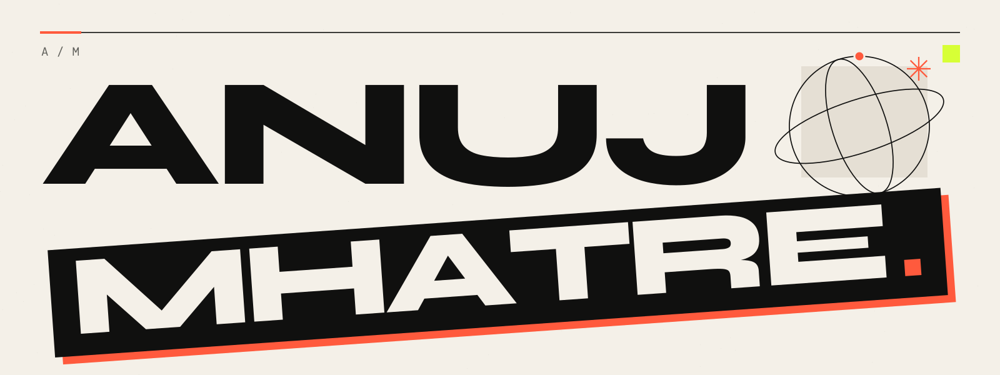

I'm **Anuj Mhatre**, a B.Tech CSE (AI & ML) student at **CSMU, Navi Mumbai**. I'm building AI and data projects, exploring how they work, and documenting what I learn.

[Portfolio](https://anujmhatre.me) · [LinkedIn](https://linkedin.com/in/anuj-mhatre-031807ma) · [Learning archive](https://credential-constellation.vercel.app)

## Selected work

**Mini-GPT** → Exploring how GPT generates text through a decoder-only transformer built from scratch in PyTorch. Causal attention and a character-level tokenizer expose the mechanics. [Source](https://github.com/mhatreanuj57-alt/mini-gpt)

**Navi Mumbai House Price Prediction** → Estimating home prices by locality and property features. A scikit-learn pipeline combines one-hot locality encoding with histogram gradient boosting. [Source](https://github.com/mhatreanuj57-alt/navi-mumbai-house-price-prediction)

**DSA Tutor RAG** → Studying algorithms through answers grounded in my own notes and C++ implementations. ChromaDB vector search and BM25 feed a reranker, with source citations in the chat. [Source](https://github.com/mhatreanuj57-alt/dsa-tutor-rag)

**Credential Constellation** → Documenting courses, badges, and hands-on learning in a static archive. Search, type filters, and full-size previews run without a build step. [Live archive](https://credential-constellation.vercel.app) · Source publication pending.

I'm also exploring developer tooling: [Agent Conductor](https://github.com/mhatreanuj57-alt/agent-conductor) for coordinating coding agents in Git worktrees, and [Draco CLI](https://github.com/mhatreanuj57-alt/draco-cli) for terminal-based coding assistance.

## Learning, documented

I keep course completions and participation records alongside my projects. A few examples:

- **AI Fluency for Students** — Anthropic course completion.
- **Introduction to Python** — IBM Career Education Program course completion.
- **AWS Cloud Club hackathon at CSMU** — participation certificate.

[Browse the full learning archive](https://credential-constellation.vercel.app/#collection-title).

## Contact

[LinkedIn](https://linkedin.com/in/anuj-mhatre-031807ma) · [Portfolio](https://anujmhatre.me)

**AM.**
