<!-- Layout and SVG geometry adapted from the user-supplied Sushmitadasari/Sushmitadasari reference ZIP. Personal content and palette replaced. -->

<a href="https://anujmhatre.me">
<picture>
  <source media="(prefers-reduced-motion: reduce)" srcset="assets/hero-static.png">
  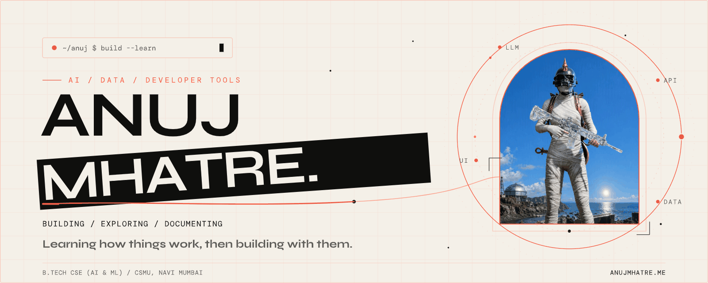
</picture>
</a>

I'm **Anuj Mhatre**, a Computer Science student specializing in AI and ML at **CSMU, Navi Mumbai**. I build projects in machine learning, retrieval, and developer tools, and share what I learn through code and documentation.

<a href="https://anujmhatre.me">
  
</a>

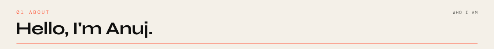

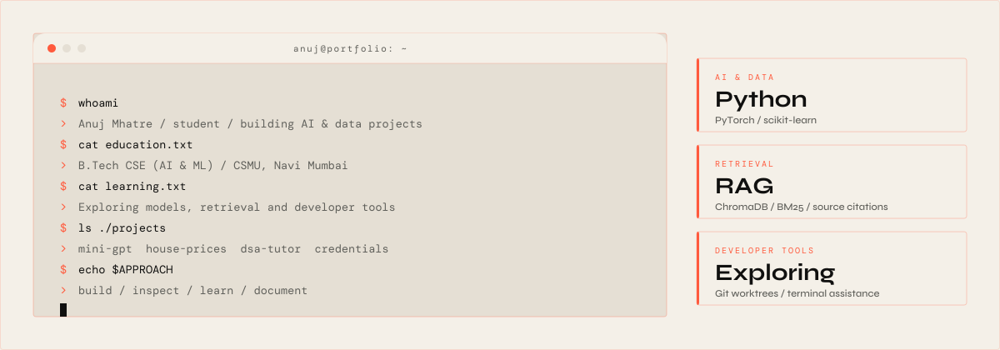

I'm building AI and data projects, exploring how they work, and documenting what I learn.

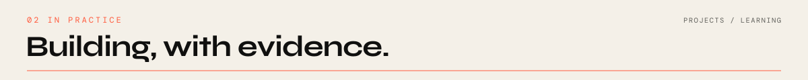

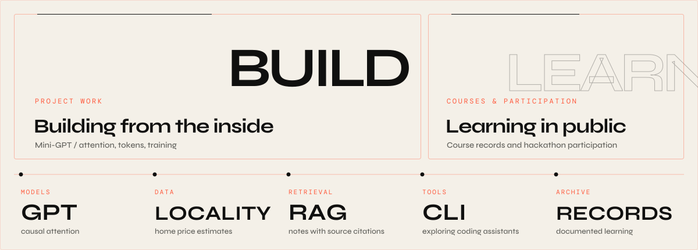

Building with causal attention, locality-aware models and retrieval from my notes; keeping course completions and participation records in my learning archive.

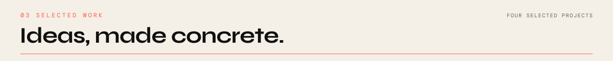

[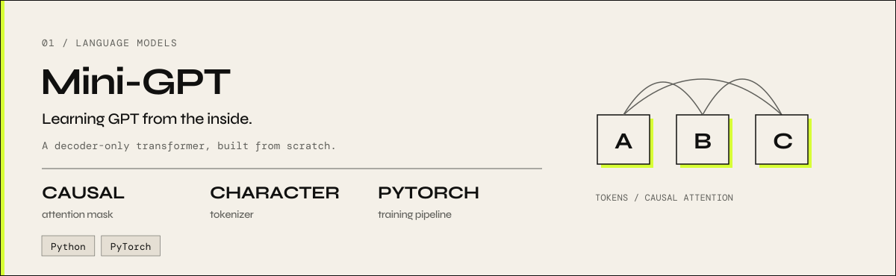](https://github.com/mhatreanuj57-alt/mini-gpt)

**Mini-GPT** — A from-scratch PyTorch decoder-only transformer with causal attention and a character-level tokenizer, alongside a separate coding-assistant demo.  

[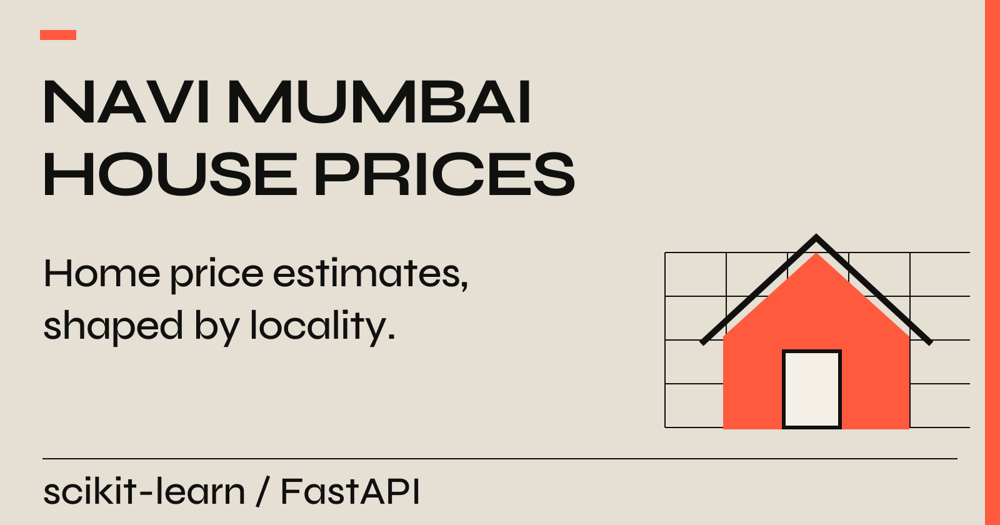](https://github.com/mhatreanuj57-alt/navi-mumbai-house-price-prediction)

**Navi Mumbai House Price Prediction** — A locality-aware home price estimation project with a Streamlit interface and FastAPI endpoint, using property features and histogram gradient boosting. 

[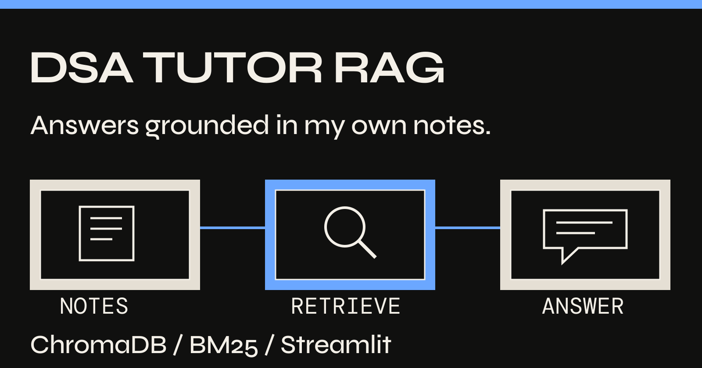](https://github.com/mhatreanuj57-alt/dsa-tutor-rag)

**DSA Tutor RAG** — A question-answering app grounded in DSA notes and C++ implementations, combining vector and BM25 retrieval with reranking and source citations. 

[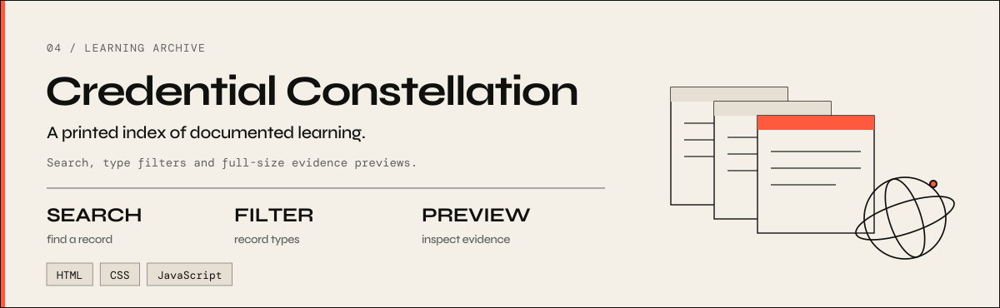](https://github.com/mhatreanuj57-alt/credential-constellation)

**Credential Constellation** — A static archive for learning records, with search, type filters, and full-size previews.  

Also exploring **Agent Conductor** for coding agents in Git worktrees  and **Draco CLI** for terminal coding assistance .

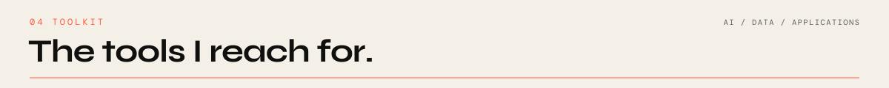

<picture>
  <source media="(max-width: 600px)" srcset="assets/toolbox-mobile.svg">
  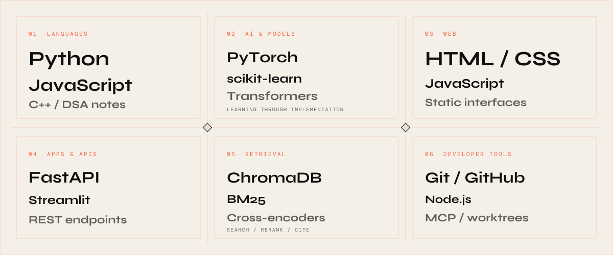
</picture>

**AI & data:** Python, PyTorch, scikit-learn. **Retrieval:** ChromaDB, BM25, cross-encoders. **Applications:** FastAPI, Streamlit, JavaScript, HTML, CSS. **Developer tooling:** Git, GitHub, Node.js, MCP. My DSA notes include C++.

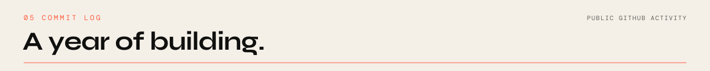

<picture>
  <source media="(prefers-reduced-motion: reduce)" srcset="assets/activity-static.png">
  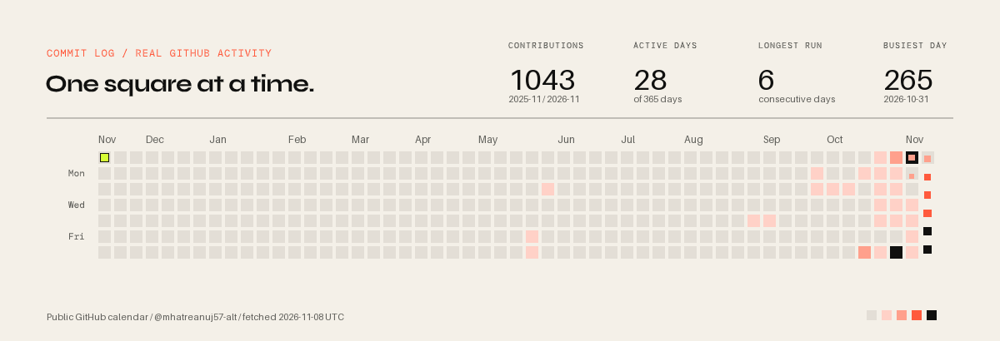
</picture>

<!-- activity:start -->
**1084 public contributions** · **31 active days** · **6-day longest active run**

2025-11-09 to 2026-11-14; fetched 2026-11-14 UTC. [Live calendar](https://github.com/mhatreanuj57-alt?tab=overview#contributions) · [Snapshot data](assets/activity.json) · [Still image](assets/activity-static.png).

**29 public repositories** · **4 repository stars** · **1 followers** (public GitHub API, same snapshot).
<!-- activity:end -->

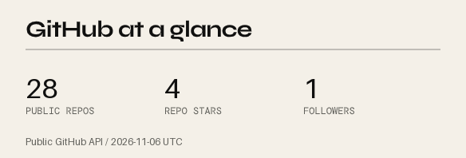

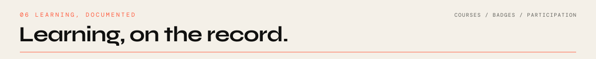

<a href="https://credential-constellation.vercel.app/#collection-title">
<picture>
  <source media="(max-width: 600px)" srcset="assets/learning-mobile.svg">
  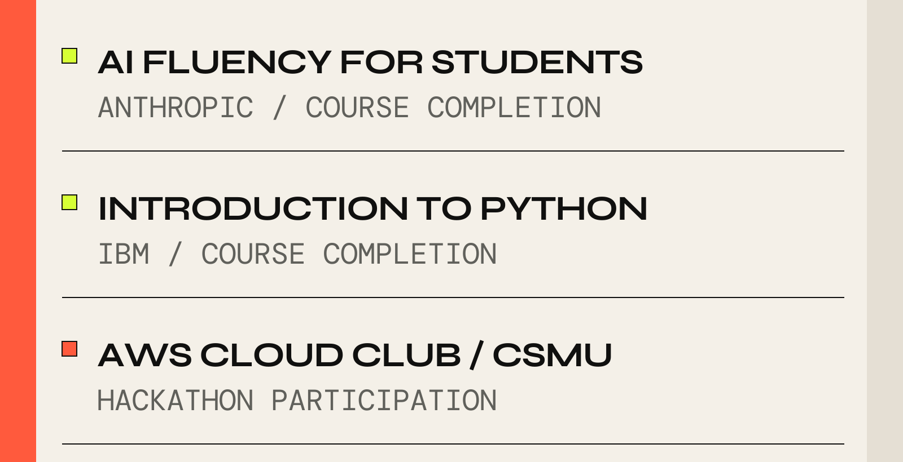
</picture>
</a>

Certificate previews — select any image to open the full certificate:

<!-- credentials:start -->

<table>
  <tr>
    <td align="center"> <strong>AI Fluency for Students</strong> Anthropic · course completion </td>
    <td align="center"> <strong>Introduction to Python</strong> IBM Career Education Program · course completion </td>
  </tr>
  <tr>
    <td align="center"> <strong>Claude Code in Action</strong> Anthropic · course completion </td>
    <td align="center"> <strong>Claude with the Anthropic API</strong> Anthropic · course completion </td>
  </tr>
  <tr>
    <td align="center"> <strong>Introduction to Generative AI</strong> Google Cloud · completion badge </td>
    <td align="center"> <strong>Introduction to Large Language Models</strong> Google Cloud · completion badge </td>
  </tr>
  <tr>
    <td align="center"> <strong>AWS Cloud Practitioner Essentials</strong> AWS Training &amp; Certification · course completion </td>
    <td align="center"> <strong>AWS Cloud Club hackathon at CSMU</strong> AWS Cloud Club at CSMU · participation certificate </td>
  </tr>
</table>

<!-- credentials:end -->

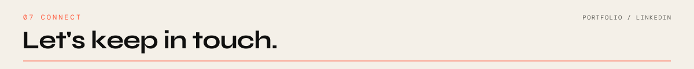

 

<a href="https://anujmhatre.me">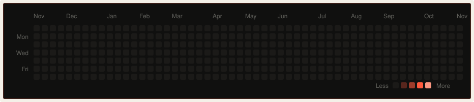</a>

[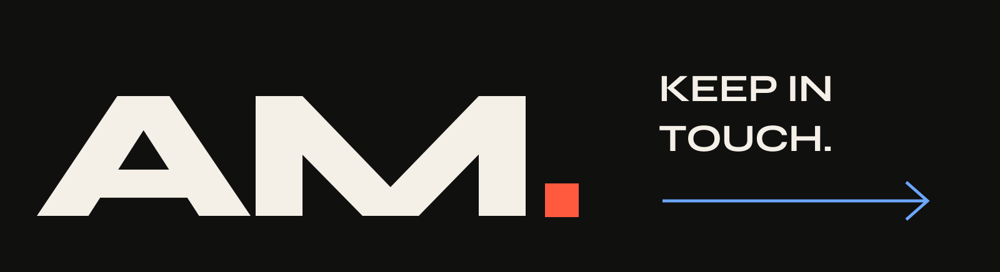](https://anujmhatre.me)

**AM.**
