<!-- Layout and SVG geometry adapted from the user-supplied Sushmitadasari/Sushmitadasari reference ZIP. Personal content and palette replaced. -->

<a href="https://anujmhatre.me">
<picture>
  <source media="(prefers-reduced-motion: reduce)" srcset="assets/hero-static.png">
  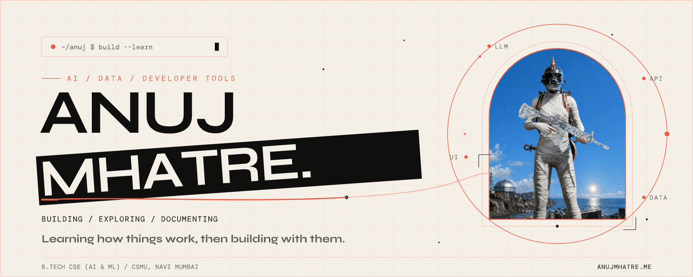
</picture>
</a>

I'm **Anuj Mhatre**, a B.Tech CSE (AI & ML) student at **CSMU, Navi Mumbai**.

[Portfolio](https://anujmhatre.me) · [LinkedIn](https://linkedin.com/in/anuj-mhatre-031807ma) · [Credential archive](https://credential-constellation.vercel.app) · [Still hero](assets/hero-static.png)

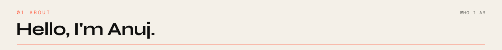

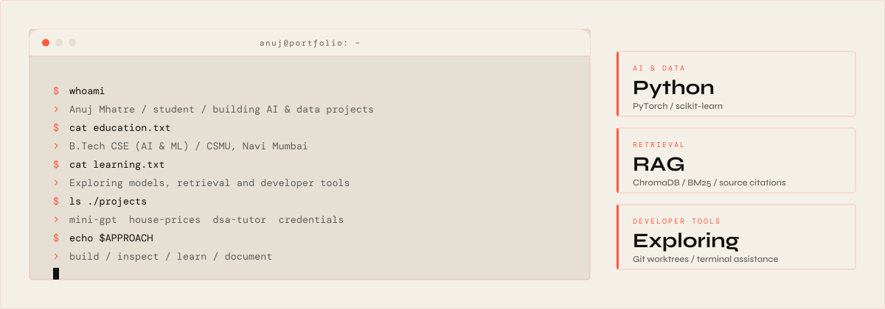

I'm building AI and data projects, exploring how they work, and documenting what I learn.

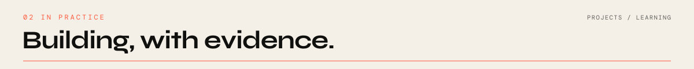

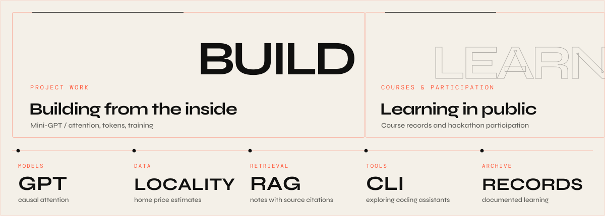

Building with causal attention, locality-aware models and retrieval from my notes; keeping course completions and participation records in my learning archive.

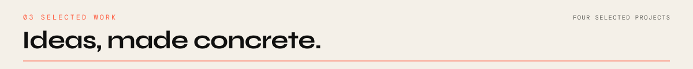

[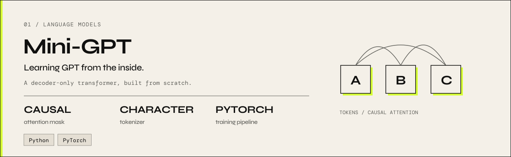](https://github.com/mhatreanuj57-alt/mini-gpt)

**Mini-GPT** — A decoder-only transformer built from scratch in PyTorch, with causal attention and a character-level tokenizer. [Source](https://github.com/mhatreanuj57-alt/mini-gpt)

[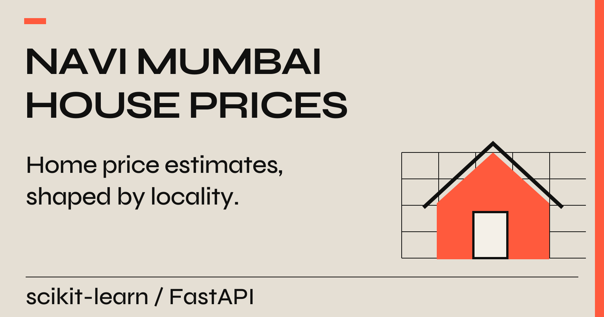](https://github.com/mhatreanuj57-alt/navi-mumbai-house-price-prediction)

**Navi Mumbai House Price Prediction** — Home price estimates from locality and property features, using one-hot locality encoding and histogram gradient boosting. [Source](https://github.com/mhatreanuj57-alt/navi-mumbai-house-price-prediction)

[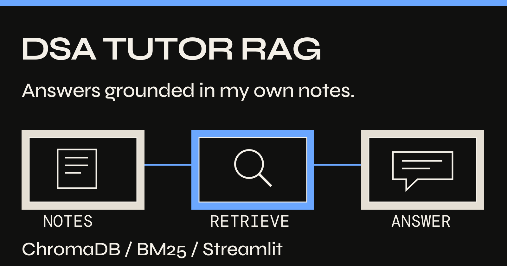](https://github.com/mhatreanuj57-alt/dsa-tutor-rag)

**DSA Tutor RAG** — Answers grounded in my notes and C++ implementations, with hybrid vector/BM25 retrieval, reranking and source citations. [Source](https://github.com/mhatreanuj57-alt/dsa-tutor-rag)

[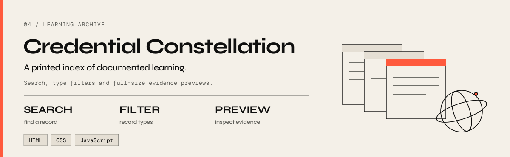](https://github.com/mhatreanuj57-alt/credential-constellation)

**Credential Constellation** — A static learning archive with search, type filters and full-size previews, without a build step. [Source](https://github.com/mhatreanuj57-alt/credential-constellation) · [Live archive](https://credential-constellation.vercel.app)

Also exploring [Agent Conductor](https://github.com/mhatreanuj57-alt/agent-conductor) for coding agents in Git worktrees and [Draco CLI](https://github.com/mhatreanuj57-alt/draco-cli) for terminal coding assistance.

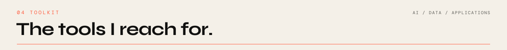

<picture>
  <source media="(max-width: 600px)" srcset="assets/toolbox-mobile.svg">
  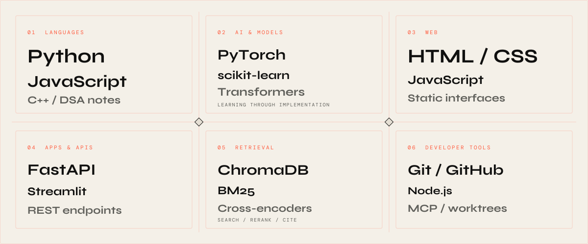
</picture>

**AI & data:** Python, PyTorch, scikit-learn. **Retrieval:** ChromaDB, BM25, cross-encoders. **Applications:** FastAPI, Streamlit, JavaScript, HTML, CSS. **Developer tooling:** Git, GitHub, Node.js, MCP. My DSA notes include C++.

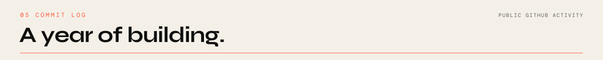

<picture>
  <source media="(prefers-reduced-motion: reduce)" srcset="assets/activity-static.png">
  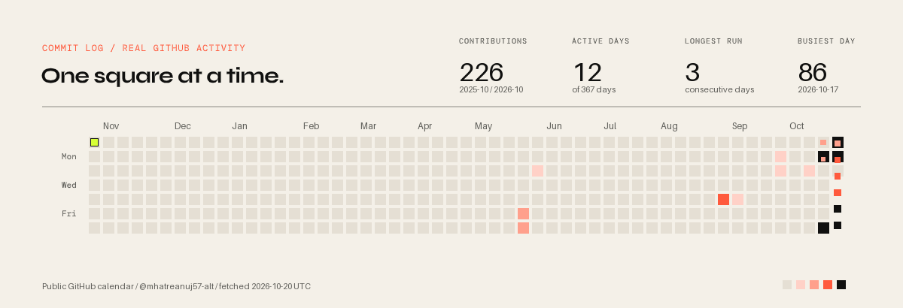
</picture>

<!-- activity:start -->
**226 public contributions** · **12 active days** · **3-day longest active run**

2025-10-19 to 2026-10-20; fetched 2026-10-20 UTC. [Live calendar](https://github.com/mhatreanuj57-alt?tab=overview#contributions) · [Snapshot data](assets/activity.json) · [Still image](assets/activity-static.png).

**25 public repositories** · **2 repository stars** · **1 followers** (public GitHub API, same snapshot).
<!-- activity:end -->

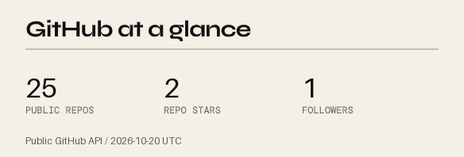

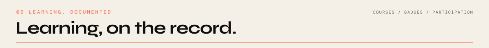

<a href="https://credential-constellation.vercel.app/#collection-title">
<picture>
  <source media="(max-width: 600px)" srcset="assets/learning-mobile.svg">
  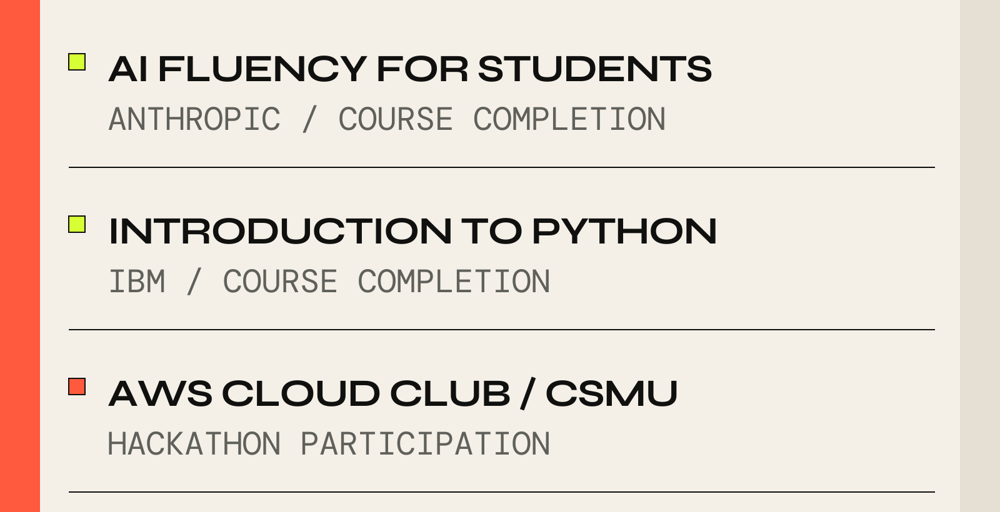
</picture>
</a>

Selected existing archive records:

<!-- credentials:start -->

- [**AI Fluency for Students**](https://credential-constellation.vercel.app/assets/credentials/ai-fluency-students-cert.png) — Anthropic, course completion.

- [**Introduction to Python**](https://credential-constellation.vercel.app/assets/credentials/ibm-python-cert.png) — IBM Career Education Program, course completion.

- [**Claude Code in Action**](https://credential-constellation.vercel.app/assets/credentials/claude-code-in-action-cert.png) — Anthropic, course completion.

- [**Claude with the Anthropic API**](https://credential-constellation.vercel.app/assets/credentials/claude-api-cert.png) — Anthropic, course completion.

- [**Introduction to Generative AI**](https://credential-constellation.vercel.app/assets/credentials/google-intro-genai-badge.png) — Google Cloud, completion badge.

- [**Introduction to Large Language Models**](https://credential-constellation.vercel.app/assets/credentials/google-intro-llm-badge.png) — Google Cloud, completion badge.

- [**AWS Cloud Practitioner Essentials**](https://credential-constellation.vercel.app/assets/credentials/aws-cloud-practitioner-essentials-cert.png) — AWS Training & Certification, course completion.

- [**AWS Cloud Club hackathon at CSMU**](https://credential-constellation.vercel.app/assets/credentials/aws-cloud-club-csmu-hackathon-cert.png) — AWS Cloud Club at CSMU, participation certificate.

<!-- credentials:end -->

[Browse the full archive](https://credential-constellation.vercel.app/#collection-title).

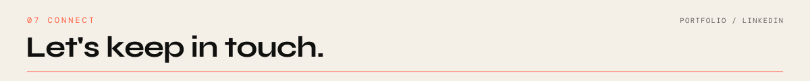

[LinkedIn](https://linkedin.com/in/anuj-mhatre-031807ma) · [Portfolio](https://anujmhatre.me)

[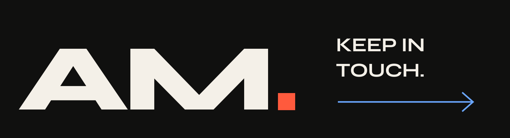](https://anujmhatre.me)

**AM.**
